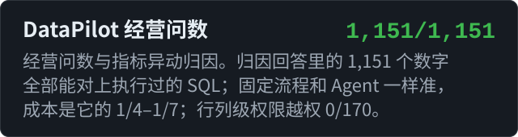

你好，我是 Kenny。我做大模型应用和 Agent，重点放在可验证上：每个设计选择都有对照实验，数字能复现，模型拿不准的地方交给规则、校验或人工。

## 项目

## 开源贡献

已合并：

- [sqlfluff #8905](https://github.com/sqlfluff/sqlfluff/pull/8905)：SQLite 方言允许 MATCH、VIRTUAL、LAST 作为标识符
- [sqlfluff #8903](https://github.com/sqlfluff/sqlfluff/pull/8903)：SQLite 方言不再把裸函数和字面量解析成列引用
- [sqlglot #8784](https://github.com/tobymao/sqlglot/pull/8784)：SQLite 中 REAL 和 FLOAT 按 8 字节 DOUBLE 解析

进行中：[agentscope #3595](https://github.com/agentscope-ai/agentscope/pull/3595)、[unstructured #4665](https://github.com/Unstructured-IO/unstructured/pull/4665)、[mirascope #2973](https://github.com/Mirascope/mirascope/pull/2973)、[DB-GPT #3306](https://github.com/eosphoros-ai/DB-GPT/pull/3306)

## 常用技术

**大模型应用：** `RAG` `Agent` `多 Agent` `工具调用` `MCP` `结构化输出` `提示缓存` `Computer Use` `多模态单据识别`

**评测：** `评测集构造` `配对显著性检验` `LLM 裁判校准` `回归门禁` `trace 与成本分析`

**工程：** `Python` `FastAPI` `SSE` `Redis` `SQLite` `sqlglot` `LangGraph` `Playwright` `Next.js` `Docker` `GitHub Actions`
