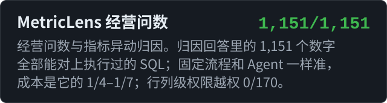
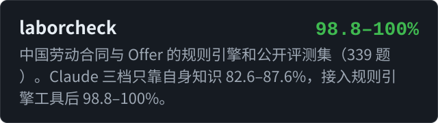
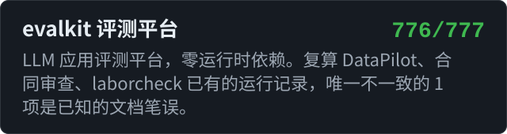

<picture>
  <source media="(max-width: 767px)" srcset="https://raw.githubusercontent.com/kennywu411-dev/kennywu411-dev/main/assets/header-narrow.svg">
  
</picture>

你好，我是 Kenny。我做大模型应用和 Agent，重点放在可验证上：每个设计选择都有对照实验，数字能复现，模型拿不准的地方交给规则、校验或人工。

## 项目

在线演示：[MetricLens 问数与归因回放](https://kennywu411-dev.github.io/metriclens/) · [采购合同审查回放](https://kennywu411-dev.github.io/contract-review-agent/) · [WebHands 操作回放](https://kennywu411-dev.github.io/webhands/) · [evalkit 评测看板](https://kennywu411-dev.github.io/evalkit/) · [laborcheck 评测看板](https://kennywu411-dev.github.io/laborcheck/)

### 其他项目

- [video-pacing 短视频节奏检查](https://github.com/kennywu411-dev/video-pacing)：检查短视频节奏的 Agent skill 和脚本，检测前 5 秒是否有钩子，以及哪些片段连续 3 秒以上没有新信息。同一条视频的初版检出 10 段等待，修改后的成片为 1 段
- [sqlguard-mcp 只读 SQL 防护](https://github.com/kennywu411-dev/sqlguard-mcp)：只读的 SQLite MCP 服务器，五层防护取自 MetricLens：语法检查、只读连接、授权回调、超时、行数上限
- [ecommerce-dashboard 跨境电商看板](https://github.com/kennywu411-dev/ecommerce-dashboard)：跨境电商经营分析看板，先定义指标口径，再设计看板。同一个“销售额”，最宽与最窄口径相差 10.7%（[在线看板](https://kennywu411-dev.github.io/ecommerce-dashboard/)）
- [quant-allocation-research 跨市场配置研究](https://github.com/kennywu411-dev/quant-allocation-research)：跨市场 ETF 配置与 A 股因子研究。回测引擎与开源库 bt 交叉核对；在含退市股的全 A 股（5,481 只）上按预先登记的门槛检验 10 个因子和 3 种合成，13 个试验通过 4 个，LightGBM 合成没有样本外增益。仅为个人研究记录，不构成投资建议

## 文章

- [Claude Opus 在 BIRD 上拿了 86.6%，但可能有一半是背出来的](https://github.com/kennywu411-dev/notes/blob/main/bird-memorized-answers.md)
- [给问数系统加了 Agent，没变准，反而贵了 56%](https://github.com/kennywu411-dev/notes/blob/main/agent-vs-fixed-pipeline.md)

## 开源贡献

已合并：

- [pint #2555](https://github.com/hgrecco/pint/pull/2555)：修正零值的相等比较，0 °C 不再等于 0 °F
- [sqlfluff #8905](https://github.com/sqlfluff/sqlfluff/pull/8905)：SQLite 方言允许 MATCH、VIRTUAL、LAST 作为标识符
- [sqlfluff #8903](https://github.com/sqlfluff/sqlfluff/pull/8903)：SQLite 方言不再把裸函数和字面量解析成列引用
- [sqlglot #8784](https://github.com/tobymao/sqlglot/pull/8784)：SQLite 中 REAL 和 FLOAT 按 8 字节 DOUBLE 解析

进行中：[agentscope #3595](https://github.com/agentscope-ai/agentscope/pull/3595)、[unstructured #4665](https://github.com/Unstructured-IO/unstructured/pull/4665)、[mirascope #2973](https://github.com/Mirascope/mirascope/pull/2973)、[DB-GPT #3306](https://github.com/eosphoros-ai/DB-GPT/pull/3306)、[astroid #3465](https://github.com/pylint-dev/astroid/pull/3465)、[pylint #11788](https://github.com/pylint-dev/pylint/pull/11788)

## 常用技术

**大模型应用：** `RAG` `Agent` `多 Agent` `工具调用` `MCP` `结构化输出` `提示缓存` `Computer Use` `多模态单据识别`

**评测：** `评测集构造` `配对显著性检验` `LLM 裁判校准` `回归门禁` `trace 与成本分析`

**工程：** `Python` `FastAPI` `SSE` `Redis` `SQLite` `sqlglot` `LangGraph` `Playwright` `Next.js` `Docker` `GitHub Actions`
